# Cata Café — Application Flows

> **These diagrams are normative.** They describe how the app is *supposed* to behave.
> Update this file **in the same PR** as any change to a flow it documents — a stale
> diagram is worse than none. (Introduced 2026-08-05 with the app-cohesion overhaul.)

Quick orientation: **Sessions** are events, **Coffees** are reusable assets,
**Groups** are standing rosters, and **UserCoffeeHistory** is the connective tissue
that turns closed sessions into per-user coffee track records.

---

## 1. Session lifecycle

Who can do what: the session **owner** (creator) has full CRUD — edit metadata,
manage samples (with guards), reveal, close, delete. A **participant** can only
evaluate and view results. Deleting a session cascades **all participants'
evaluations**, physical/extrinsic data, invites, and its tasting-history rows.

**Registered-only creation (S8-03):** `createSession`, `createExpressSession`,
`createGroupSession` and `duplicateSession` call `requireRegisteredUser()`
(`lib/auth.ts`); an anonymous QR guest gets the same refusal as a stranger even
by a direct POST (`proxy.ts` only gates pages). Guests keep `requireUser()` for
join, evaluate, submit, waiting room, offline replay and claim.

**Create and edit robustness (S8-10):**
- The wizard actions run under `run()` (design b): validation keeps its
  `{ ok:false, error:<wizard code> }` shape, a thrown failure (expired auth, DB)
  becomes `{ ok:false, error:<ActionErrorCode> }`, so the form stays mounted with
  its state. `redirect()` still passes through. After a group create the address
  bar moves to the owner-only `sessions/[id]/invite` route (404 for anyone else),
  which re-reads the latest usable invite, so a reload keeps the link.
- Edit: format/cups freeze at `startedAt` OR the first evaluation (C6 default);
  only values that differ from the stored session count as a change. Removing a
  sample counts evaluations, physical and origin data INSIDE the delete
  transaction. Marking a rated sample as reference needs `confirmRepin`
  (B2 default: replace, warn first). `addSessionSample` takes its position inside
  the transaction and retries on a collision.
- Duplicate copies every `referenceRank` (B8 default: all); a coffee the caller
  can no longer use becomes a coffee-less sample.
- `submitAllEvaluations` returns `ActionResult<{ closed, submitted }>`; a second
  submit after the solo auto-close is the final state, not an error. The module
  JSON is bounded in `computeEvaluationDerived` (note 500, module 64k).
- Naming a coffee on a coffee-less sample creates and links it in one transaction.

### The one close routine (2026-09-08)

Every path that ends a session goes through `closeSessionInternal`
(`lib/closeSession.ts`), in **two phases** (S8-05). Phase 1 is the **idempotent**
status flip (`updateMany where status != closed`, stamps `closedAt`). Phase 2,
`finalizeClosedSession`, is **reveal every coffee-linked sample** -> refire the
aggregate trigger -> `syncCoffeeHistoryForSession` -> close emails (group only) ->
stamp `closeFinalizedAt`. A failed phase-2 step is logged at error level
(`closeSession.finalize`) and leaves the stamp null, so the work is owed: the
solo owner's resubmit, an owner close (after 5 minutes) or the daily cron's
repair pass runs phase 2 again (every step is idempotent, the email ledger skips
sent recipients). A finalized session is a no-op. Close emails (each participant gets a
link to their results page via login `next=` plus their personal summary PDF —
`lib/closeEmail.ts`; the full CVA form is downloaded from the results page; legacy
attach with `CLOSE_EMAIL_ATTACH_CVA=1`; see §6). A second click, a
concurrent call or a cron retry is a no-op — nothing is re-synced or re-sent.
Once closed, a session is **read-only**: every mutation runs
`assertSessionWritable` and throws `session_closed`; `/cup` redirects to
`/results`; offline drafts for a closed session are NOT replayed and NOT shown
as synced: `replayEvaluation` / `replayPhysical` / `replayExtrinsic` answer
`closed`, the device keeps the module as `closed_unsent` (badge + notice) and the
results page tells the cupper whether their unsent notes counted.

**Unsent work at close (Kim C1, default b).** Complete drafts that were never sent
are left OUT of the results (`DRAFT_AT_CLOSE = "exclude"`, `lib/closeRules.ts`);
they stay in the database. The owner's close dialog shows how many cuppers hold
such notes (`getCloseImpact`) and states the rule; the close email repeats the
rule and tells each affected cupper. A 24 h reminder (`deadline_24h`) goes to them
before an async deadline. `promote_complete` (submit complete drafts at close) is
implemented as a constant only: off. // TODO(S8-05/C1-d): the owner "accept late
contribution" action is a post-close write and awaits Kim.

**Expiry rule (S8-01).** A session is also read-only once its `closesAt` has
passed (`isSessionExpired`, strict `<`, server clock) even though `status` stays
`active` until the daily cron or the owner closes it: `assertSessionWritable`,
`joinViaToken` (newcomers), the `/cup` and `/waiting` redirects, `sessionHref`,
the offline replay and the results page all use the same helper, so writing stops
at the instant group results open. `submitAllEvaluations` flips drafts with a
conditional `updateMany` (open sessions only), so a close racing a submit cannot
be written past. `updateSession` is the one exception: it stays status-only so the
owner can still move a passed deadline. A participant cannot write to a live
group session before the master starts it (`assertSessionStarted`,
`session_not_started`); offline replay keeps such a draft pending, never
discarded.

**Written list after close** (everything else throws `session_closed`; enforced by
`tests/useServerExports.test.ts`): `upsertExtrinsic` via `ExtrinsicEditDialog`
(owner, revealed sample), `updateSampleMetadata` naming a coffee-less sample
(owner), and, pending the S8-12 decision, the owner's `setParticipantExclusion` and
`refreshAggregateScores`. `closeSession`, `startSession`, `resendCloseEmails`,
`deleteSession` and `duplicateSession` are lifecycle actions, idempotent or allowed
on a closed session by design.

**The database says the same (PHASE 21).** The browser key is SELECT-only on the
session tables: no `INSERT/UPDATE/DELETE` for `anon`/`authenticated`, a participant
reads only their own `evaluations` (the owner also reads submitted rows), and
`aggregate_scores` stays hidden from participants until `can_view_group_results`.
Writes happen only in server actions (Prisma as `postgres`).

### Solo sessions

`createSession` sets `status: "active"` immediately (there is no meaningful
"draft" for solo). The session **auto-closes** when the owner has a *submitted*
evaluation for **every** sample (`maybeAutoCloseSoloSession` inside
`submitAllEvaluations`, `app/actions/community.ts`, `emails: "skip"`).

**Express — "Catar ahora" (2026-10).** `createExpressSession` (`app/actions/sessions.ts`,
`run()` → `ActionResult`) creates the same active solo session from a phone in
three taps — name → format → sample count (1–20, rules in `lib/expressSession.ts`)
— with `cupsPerSample: 1` and every sample **coffee-less** (`coffeeId: null`,
labels "Muestra A…"). The full wizard's `validateSessionInput` is untouched and
still requires a coffee per sample. Entry points: dashboard header + empty state
and the sessions list header, all `GuestGateLink` (`/app/sessions/express` is
outside the guest scope, so proxy and link agree). Lifecycle afterwards is
identical to any solo session (auto-close on submit-all).

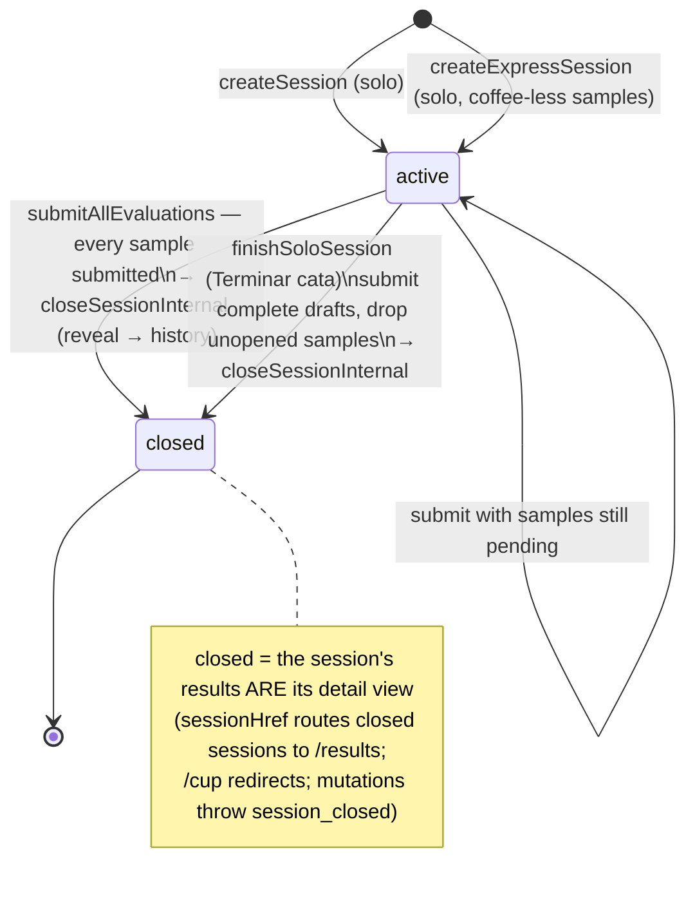

**Manual finish (S8-05, the one bend of "no manual close for solo").** A solo or
express session with fewer cupped than created samples never auto-closes.
`finishSoloSession` (owner, solo only) submits the owner's COMPLETE drafts
(`lib/closeRules.ts planFinish`, same completeness as the results page), removes
only samples with no evaluation at all (`lib/sampleRemoval.ts`, shared with
`removeSessionSample`: reference ranks and positions are repaired), keeps partial
drafts without a score (Kim C2 default a; no editing after closing) and then calls
`closeSessionInternal`. Surfaces: the submit-guard dialog ("Terminar con las N que
catié", with the outcome stated beforehand) and a "Terminar cata" button on the
results banner. Group sessions never see it.

### Group sessions (live and async)

`createGroupSession` starts at `active`, creates the owner's participant row and
an invite token, and (optionally) emails the linked group. Participants join via
`/join/[token]` (owner and existing members re-opening the link are no-ops; a
closed session's link sends members to results and refuses newcomers; `maxUses`
is enforced inside the transaction). The page and `joinViaToken` share one pure
rule, `evaluateJoin` (`lib/joinRules.ts`, S8-11): owner/member → straight in via
`sessionHref` (even with a dead link) · a newcomer to a closed session → "cerró"
(NO anonymous sign-in is attempted) · `entriesLocked` → "entradas cerradas" ·
revoked or expired link → "ya no sirve" · `maxUses` reached → "sin lugares" ·
unknown token or a solo session → "no válido"; each state has its own es/en
copy, and a latecomer on a started session is told they can cup every sample.
The owner's master panel keeps ONE link: "Invitar" returns the newest active,
unexpired invite (`createInviteToken` is idempotent), "Regenerar enlace"
(confirm) sets `SessionInvite.active = false` on every earlier token and mints a
new one in one transaction, and the print QR reads the same active invite. The
panel also toggles `CuppingSession.entriesLocked` (`setEntriesLocked`, owner):
newcomers get `entries_closed`, members re-enter; the flag is gating only and
never read by scoring. The "N de M enviaron todo" counter counts eligible
cuppers (joined or owner, not excluded) with a submitted evaluation for EVERY
sample (`lib/submitProgress.ts`); the client holds a `Map<cupperId, sampleIds>`
re-seeded from the server on every refresh, SUBSCRIBED and visibility change.
The waiting room refetches `getWaitingState` on SUBSCRIBED, visibility,
`pageshow` and `online`, and its fallback poll runs every 15 s ± 3 s. For a **live** session they wait in
`/waiting` until the owner calls `startSession` — from wizard step 2 **or** the
master panel's "Iniciar cata" (idempotent). An **async** session (`isAsync`,
`closesAt` set) lets them cup immediately and is closed by the **daily cron**
(`/api/cron/close-expired-sessions`, 06:00 UTC) once `closesAt` passes, or
earlier by the owner. `closesAt` is the END of the chosen calendar day **in the
owner's IANA zone** (`closesAtZone`, posted from the form's browser;
`endOfDayInZone`, `lib/closeRules.ts`; a null zone is UTC, the legacy rule), so
writes stop at the owner's midnight and the cron closes the session on D+1 in the
early morning — never before the day the owner picked has ended. Everyone who can
open the session sees the date (`DeadlineBanner`: join confirmation, waiting
screen, cup header, session list) in the owner's zone with the viewer's local time
beside it when they differ, stronger in the last 24 h. The cron also sends the
`deadline_24h` reminder and, for a forgotten live session, one `live_idle`
reminder to its owner (never a close); both are ledgered in
`session_reminder_deliveries`. Setting a date on an unstarted live session turns it
self-paced (no waiting room, no "Iniciar cata"), which the forms say before saving
(// TODO(S8-05/C7): separating `isAsync` from `closesAt` awaits Kim). From
`closesAt` on, though, the session is already read-only and its group results are
visible (expiry rule, §1 above): the cron only flips `status` and sends the emails. Close emails are queued with `after()` and ledgered per
recipient in `close_email_deliveries`; the owner sees sent / no-email / failed /
pending on the results page and can "Reenviar" (only unsent recipients go out).

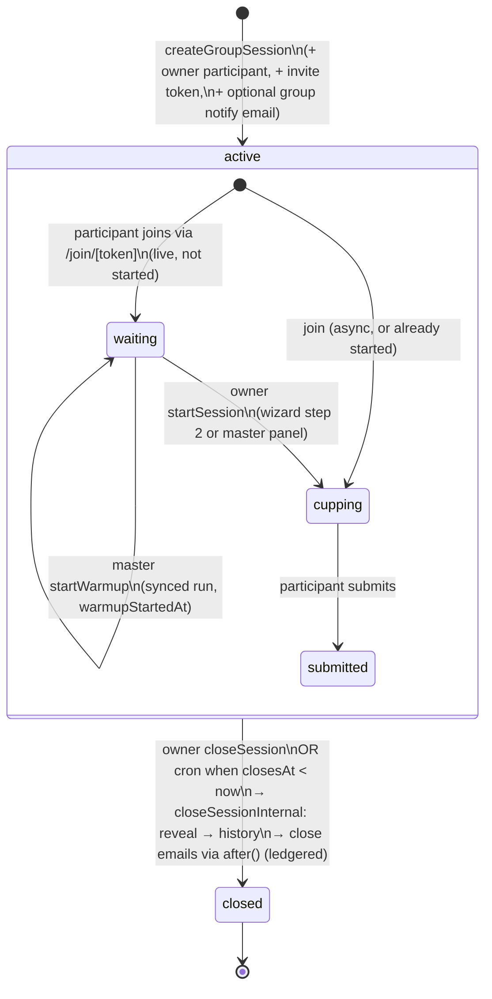

#### Warm-up (Movimiento Sensorial, 2026-10)

`warmupExerciseId` is optional and can only be changed while the session has not
started and has no evaluations (`updateSession` throws `warmup_locked` after
that). The waiting room puts the chosen exercise first ("Tu maestro eligió");
finishing or skipping it marks it seen per (session, user, exercise) in
localStorage (`cata_moment_warmup_<sessionId>_<userId>` = exercise id). If
`startedAt` arrives during the exercise, a docked bar offers "Ir a la mesa" and
the room moves on at the next segment boundary, or after 30 s at most. On
`/cup` the overlay shows once, only to a cupper with no evaluation yet, and
never to the master of a live group session. A live session that has not started
redirects participants from `/cup` to `/waiting`.

**Synced run (PR3).** Before the cupping starts, the master panel offers
"Empezar con el grupo" when the session has an exercise. `startWarmup` (owner
only, `assertSessionWritable`) stamps `cupping_sessions."warmupStartedAt"` — the
t0 of the timeline, i.e. the start of "Llega" (the intro is not timed). It only
takes effect for a live (`isGroup`, not `isAsync`), active, not-yet-started
session with an exercise, and is idempotent: a second click joins the run in
progress instead of restarting it (a run older than the exercise length counts
as finished). The master's own device plays the exercise with sound as an
overlay on `/cup`, seeked, and the panel shows "En curso · Quedan m:ss",
"Volver al ejercicio" and "Detener" (`stopWarmup` sets the column back to
`NULL` while `startedAt` is still null). Waiting rooms receive the value on the
existing `waiting:<id>` realtime channel (edge-detected, because full-row
payloads re-deliver the same value on unrelated updates) and open the player in
`synced` mode seeked to `now − warmupStartedAt`: live events clamp the offset to
at most 2 s, reloads and polls use the server clock (`serverNow`) to cancel
device skew. **Sound is off by default for participants** — the master's device
is the one sounding device in the room; a participant can unmute from the
player's top bar. With fewer than 20 s left the run counts as "missed" and the
exercise is offered solo instead; `warmupStartedAt` going back to `NULL` after a
value shows "El maestro detuvo el ejercicio". As a fallback for a dead realtime
channel the waiting room polls `getWaitingState` every 15 s (`startedAt`,
`warmupStartedAt`, `warmupExerciseId`, `serverNow`); the older boolean
`checkSessionStarted` is kept unchanged on purpose. Pressing "Iniciar cata"
while a run is in progress asks "El grupo está en el ejercicio (quedan m:ss).
¿Iniciar igual?" before calling `startSession`. The seek/skew/missed arithmetic
lives only in `lib/warmup/syncedRun.ts`.

### Deleting a session (2026-09-08)

The owner may delete a session at any time. The confirm dialog (fed by
`getDeleteImpact`) lists the coffees involved **with their owners** — coffee
records and their statistics belong to those owners and are never touched — and
states how many cuppers' evaluations will go. Inside the same transaction,
`detachCoffeeHistoryForSession` first guarantees every cupper a
`UserCoffeeHistory` row per **revealed** coffee-linked sample they submitted (a
never-revealed blind sample is skipped, so the coffee name never leaks, S8-02; label-only rows await Kim D8) carrying a `snapshot` of **their own** evaluation + session metadata; then
the session is deleted and the history rows' `sessionId`/`evaluationId` go
`NULL` (`SetNull`) instead of cascading away. Profile history, coffee detail and
the dashboard read `snapshot` for those rows and label them "Sesión eliminada".

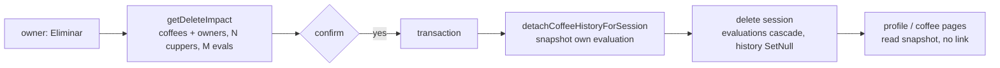

### Guest join & conversion (email capture)

`/join/[token]` requires no account: a walk-up participant enters only a display
name (`GuestJoinForm` → `supabase.auth.signInAnonymously()` →
`completeGuestOnboarding` → `joinSessionAsGuest` (an `ActionResult` wrapper over
`joinViaToken`)). The form is only rendered for a link `evaluateJoin` admits. Their evaluations belong to an
anonymous auth user (NULL email). On the **results** page an anonymous viewer
sees a dismissible "Guarda tus resultados" banner (`GuestSaveCta`). It reuses
the **normal account-creation flow** rather than inventing one: `startGuestClaim`
mints a signed 7-day claim token for the anonymous id and sends the guest to
`/auth/login?next=/auth/claim?token=…` (magic link or Google — the same
double-opt-in every account gets). After sign-in, `/auth/claim` shows a
confirmation card naming the guest participation (never merges on a GET);
confirming runs `mergeGuestData` (`lib/guestClaim.ts`) which moves every row
the anonymous user owns — evaluations, participation, coffee history, created
sessions… — onto the signed-in account (**new or already existing**), deletes
the anonymous user, and returns to the results page. Never gate *joining* on an
email — valor antes que fricción (see PRODUCT.md).

**Guest scope in the app shell.** A guest may open Inicio, Sesiones, their own
session pages (cup / waiting / results / print) and **Perfil** (+ history) —
`lib/guestScope.ts`. The nav is the SAME for everyone; tapping a gated tab or
CTA (Cafés, Grupos, Insights, Nueva sesión, a coffee detail) as a guest opens the
"Termina de crear tu cuenta" modal (`GuestGateProvider` / `GuestGateLink`) whose
CTA is the claim flow above, returning to the destination they wanted. Typing a
gated URL directly is still refused server-side by `proxy.ts`, which redirects to
`/app/sessions?gate=1` so the same modal opens. The profile page shows an
"Invitado" badge and a "Terminar de crear tu cuenta" button in place of the email.

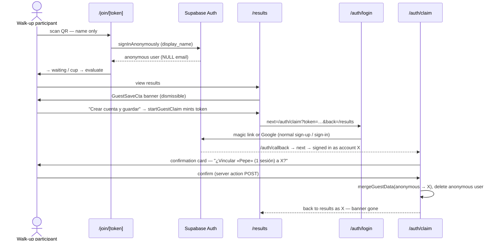

### Where a session link takes you (`lib/sessionRouting.ts`)

```mermaid
flowchart LR
    A[Session row clicked] --> B{closed OR closesAt passed?}
    B -- yes --> R[/sessions/id/results/]
    B -- no --> C{live group (not async) && !startedAt\n&& viewer is not owner?}
    C -- yes --> W[/sessions/id/waiting/]
    C -- no --> K[/sessions/id/cup/]
```

Every list (sessions, dashboard, profile, group page) must use `sessionHref` —
never hardcode `/cup`. Its input must include `closesAt` and `isAsync` (the type
requires both): an unstarted **async** session has no waiting room, so it goes
straight to `/cup` (S8-11).

### Sample / coffee metadata lifecycle (progressive)

Creation only requires a **name** — the wizard and coffee forms range-check
altitude only when a value is given, and roast level is optional (*valor antes
que fricción*: name-only entry, everything else fillable later). Metadata can
then be edited at any point in a sample's life: coffee fields + label via
`EditSampleMetadataForm` (from the cup page and the results drill-down), and
origin/processing data post-close via `ExtrinsicEditDialog` on the results
drill-down (owner + revealed samples only). Both routes go through `updateSampleMetadata` /
`upsertExtrinsic`, which **merge** rather than overwrite — an absent key
leaves the coffee field untouched, `""` clears it, `name` is never blanked —
and report `coffeeUpdated: false` (shown as a dismissible notice) when the
linked coffee isn't owned by the editor.

**Post-close coffee naming (2026-10, express sessions).** A coffee-less sample
(`coffeeId: null` — every express sample starts like this) may get its coffee
**after** the session closed: the results drill-down shows the owner "Asignar
café", which opens the same metadata dialog; `updateSampleMetadata` allows the
call on a closed session only when the caller is the owner, the sample has no
coffee and the input carries a coffee field (a label-only rename still throws
`session_closed`). It creates the private coffee, links it, sets `revealed:
true` and re-runs `syncCoffeeHistoryForSession` so the cupper's history row
appears. This is the second sanctioned post-close write (the first is
`ExtrinsicEditDialog` → `upsertExtrinsic`).

### Reference sample (2026-09)

The owner may mark exactly one sample per session as the "Referencia" (control
sample the others are compared against) from the wizard, the sample edit page,
or the cup page's master panel — `CuppingSession.referenceSampleId` (nullable,
`SET NULL` on sample removal, remapped by position on `duplicateSession`) via
the owner-only `setReferenceSample` action. It goes live to participants
through the existing `cupping_sessions` realtime UPDATE stream — no new
publication or RLS policy. Results and the PDF/print sheets show a
"Referencia" badge on that sample and a display-only signed Δ against it
(community score in group sessions, own CVA score solo) computed by
`lib/referenceDelta.ts`; scoring itself, the DB trigger, and RLS are untouched.

**2026-09-25 — reference cupped first, pinned quality:** three rules layered on
top of the above, all in `lib/referenceRules.ts`. **Order:** the reference is
cupped FIRST — `orderReferenceFirst` puts it ahead of the rest (who keep their
position order) everywhere samples are listed: cup tabs and Anterior/Siguiente,
the waiting room, results tables/radar/owner matrix, the CVA PDF, print, and
close emails. Changing the reference mid-session swaps the order live for
everyone and keeps each cupper on the sample they were viewing. **Pin:** on the
reference sample, every affective attribute is locked at 5 and the cup checks
are cleared, so every cupper's reference score is exactly 79.00 and only the
descriptive side stays editable (affective/combined formats only — enforced
server-side on every save via `pinReferenceAffective`, mirrored client-side as
a locked, explained UI). Existing scores entered before the lock are never
rewritten. **Anchor:** results treat the reference as context, not a
competitor — it is pulled out of the ranking, the session average and "Mejor
muestra" into its own card above the ranking; the Δ against it is unchanged.

**2026-10 — multiple references (Referencia 1 / 2):** references ACCUMULATE
instead of replacing. `SessionSample.referenceRank` (1, 2, 3 — unique per
session, max 3) records the order they were named; `referenceSampleId` stays
the ACTIVE one (highest rank), so ordering, pin, realtime and the default Δ keep
working. `setReferenceSample(sessionId, sampleId)` on a sample that is not yet a
reference gives it `max+1` and makes it active (re-pinning its stored rows to
79.00); naming an existing reference is a no-op; `null` removes only the active
one and the previous becomes active again. Only the ACTIVE reference is pinned
— earlier ones keep the pinned data their cuppers saved but unlock, so a cupper
can change that note. All references are cupped first by rank
(`orderReferencesFirst`), are anchors in results (excluded from ranking,
average and "Mejor muestra") and the "Comparar con: Referencia 1 · Referencia 2"
selector (client state, `localStorage` `cata_results_ref`, active by default)
chooses the Δ basis. Tabs show R1/R2, PDFs/print/close emails "· Referencia N".
Scoring, the trigger and `AggregateScore` never read any of this.

---

### Sign-in, deep links and the confirm page (2026-11, S8-06)

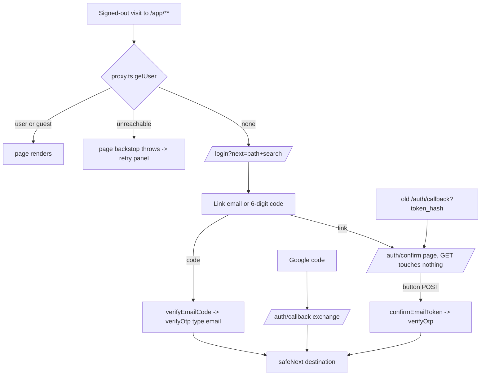

- One `next` validator (`lib/safeNext.ts`): same-site path or same-origin absolute URL; rejects `//x`, `/\x`, `@`, encoded slashes and `/auth/{callback,confirm,login}` (loops). `/auth/claim` is allowed (guest claim chain).
- `lib/authState.ts` classifies `user | none | unreachable`; anonymous guests are `user`. Only `none` redirects to login; a down auth service shows the error boundary's retry panel.
- A GET never consumes a token. The guest-claim chain is unchanged: login `next=/auth/claim?...` -> confirm -> claim page (login-then-confirm, never a merge on GET).
- Language: `signInWithMagicLink(formData, next, locale)` sends `preferred_lang` (new accounts only) and defaults `next` to `/{locale}/app`; `signOut(locale)` lands on `/` or `/en`; the ES/EN switch keeps page, query and hash (`lib/localeSwitch.ts`).
- The welcome dialog mounts only on `/app` itself and never for guests; closing it (X, Esc, skip) calls `dismissOnboarding`, which sets only `onboardingCompleted`.

### Account lifecycle and guest safety (2026-11, S8-07)

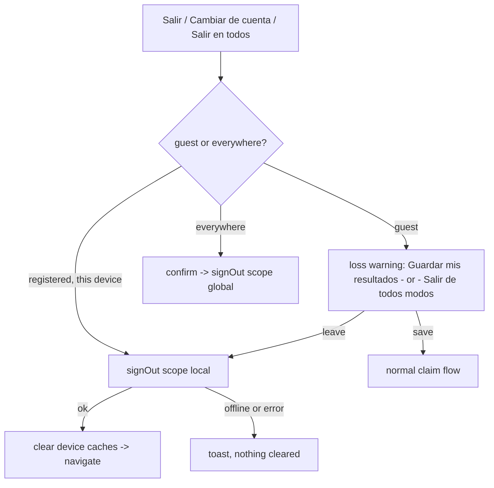

- **Sign-out**: `signOut(locale, scope)` / `switchAccount(locale, next?)` return `ActionResult<{ next }>`; the client clears `cata-pages-*`/`cata-rsc-*`, the last-user pointer and the seen-set only after the server confirmed. Default scope is `local` (this device); `global` is the explicit "Salir en todos los dispositivos". A guest always sees the loss warning first (`GuestGateProvider.leave` carries the copy). Unsynced-draft warning is S8-09.
- **Claim hardening**: `lib/guestClaimToken.ts` is the pure half (token, `safeClaimBack`, `anonEvalWins`). `confirmGuestClaim` returns an ActionResult: `invalid_token` / `token_expired` / `not_found` (already linked) go to the page's final cards, anything else shows a RETRY card (the merge is one transaction, safe to repeat). `mergeGuestData` separates `lookup_failed` (auth service blip, retry) from `not_anonymous` (final), runs with a 30 s transaction timeout, and re-fires the aggregate trigger only for samples where an evaluation was deleted by a conflict and sessions where an exclusion flag was merged. The card offers "Usar otra cuenta" (signs out this device and returns to the same claim) and "No vincular" (behind a warning) instead of "Cancelar".
- **7-day claim token (F-guest-9, accepted risk)**: it is a bearer token in the guest's own URL/email. Anyone holding it who signs in can only reach a confirmation card naming the guest and counts; nothing merges on a GET, and the merge refuses a source that is no longer anonymous. TTL stays 7 days so a re-sent magic link still redeems.
- **User columns**: `lib/accountDeletion/manifest.ts` lists every `Profile` FK and bare user column (`CloseEmailDelivery.userId`, `AiChatUsage.userId`, `OutboundEmailEvent.actorKey` = `u_<id>`, waitlist by email) with its merge rule and its INTENDED deletion rule. `tests/profileRelations.test.ts` fails on an unlisted relation and checks the merge source for each listed table. `deleteAccount` is not built (tombstone design, E3/E4 owner choices); when it is, it is a NEW sanctioned write on closed sessions and §1 must say so.
- **Guest join**: `checkJoinable(token)` (`lib/joinability.ts`, same rule as the `/join` page and `joinViaToken`) runs before `signInAnonymously`; a closed link shows its own state to a visitor with no session (a signed-in participant still reaches results through `joinViaToken`); a retry reuses the anonymous user the earlier try created.
- **Email change**: registered users only (`requestEmailChange`), mails a confirmation through `/auth/confirm` (type `email_change`) back to `/app/profile`; the profile shows `new_email` as pending until it is confirmed.

## 2. Coffee visibility & sharing

A coffee is a reusable asset owned by its creator (producer/roaster/café). The
owner has full CRUD (`createCoffee`, `updateCoffee`, `deleteCoffees` / `deleteCoffee`,
`setCoffeeVisibility`, `setCoffeeResultsPublished`); everyone else only *uses*
usable coffees in sessions. Two independent switches: `visibility` (who sees the
record) and `resultsPublished` (who sees the aggregated results block).

```mermaid
flowchart TD
    subgraph states [visibility]
        P[private] -- "createCoffeeInvite()\n(link mints ⇒ intent to share)" --> S[shared]
        S -- setCoffeeVisibility --> PUB[public]
        S -- "setCoffeeVisibility(private)\nshare rows stay but go INERT" --> P
        PUB -- setCoffeeVisibility --> S
    end
    S -- "join link /join/coffee/[token]" --> CS[CoffeeShare row\n(per user)]
    CS --> U[usable by that user]
    PUB --> U2[usable by everyone]
    P --> U3[usable by owner only]
```

`usableCoffeeWhere(userId)` (`lib/coffeeAccess.ts`) is the single read rule:
not anonymized ∧ (owned ∪ public ∪ (shared ∧ has share row)). The session wizard
and `addSessionSample` both re-validate picked coffees against it server-side.

**Delete = anonymize (2026-09-26).** `deleteCoffees(ids)` (owner only — the
`createdBy` predicate on the `updateMany` is the gate; the super-admin cannot)
never removes the row. It wipes the identifying fields (`name` → "", `code`,
`farm`, `producer`, `notes` → null, `certifications` → [] —
`ANONYMIZED_COFFEE_DATA` in `lib/coffeeAnonymize.ts`), resets visibility to
private / results unpublished, deletes `coffee_shares` + `coffee_invites`, and
stamps `deletedAt`. Everything derived from a tasting keeps pointing at the row:
`session_samples`, `evaluations`, `aggregate_scores`, `user_coffee_history` —
so insights still correlate perceived notes / quality with country, variety,
process, altitude, harvest and roast. Display sites render
`common.coffeeDeleted` ("Café eliminado") via `coffeeDisplayName()` because a
live coffee never has a blank name. `getCoffeeDeleteImpact(ids)` feeds the
confirm dialog (samples / sessions / cuppers that KEEP their data). Entry
points: the coffee-list row trash icon, the bulk-selection toolbar
(`DataTable` `selection` prop, ≤ `MAX_BULK_COFFEE_DELETE`) and the profile
page — all through `components/coffees/DeleteCoffeeButton.tsx`.

### Coffee codes

Every coffee gets a unique 6-char short code (`lib/coffeeCode.ts`) at creation —
`createCoffee`, the session wizard (`resolveCoffees`, with whole-batch retry on
a within-transaction collision), `updateSampleMetadata`'s implicit create, and
`duplicateCoffee` all stamp one. It's the external identifier people quote to
each other ("mi café es el código K7M-3FP"): shown as a pill on the coffee
detail header and in `CoffeesTable`, and searchable in `CoffeePicker` — a
3+ char code-prefix query ranks above fuzzy name matches but never replaces
them.

---

## 3. Group membership, invites & announcements

Groups are email-first: a `TastingGroupMember` row can exist before the person
has an account. Linking happens two ways: the `handle_new_user` DB trigger on
signup, or `claimGroupMembershipsByEmail` on every groups page load (covers
people who already had an account when invited).

Owner: full CRUD + roster management + announcements + email blasts. Member:
read the group (feed, roster, sessions) and **leave** (`leaveGroup`). There are
no co-admins; being added *is* membership (no pending state).
Group emails that carry a session link (`sendGroupEmail`, `notifyGroupOfSession`)
build it with `groupSessionInviteUrl` (`lib/inviteUrl.ts`): a linked member goes
straight to `/join/[token]`, an unlinked recipient through `/auth/login` with the
join as `next`; both reject a session that is not an active group session of the
caller (`invalid_input`).

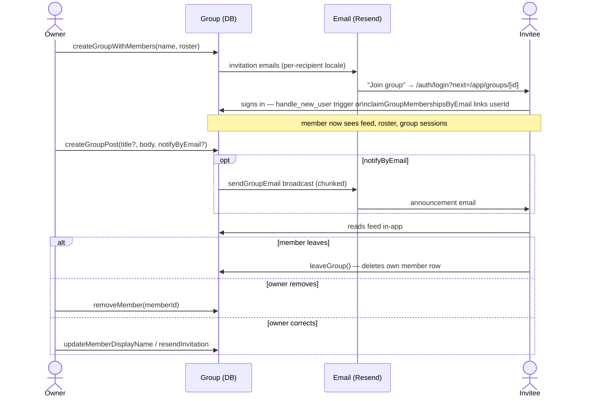

**Group email (S8-03).** Every group action is registered-only. All group mail
(broadcast, session notice, announcement blast, invitations, resend) goes through
one sender, `deliverGroupMail` (`lib/groupEmail.ts`):

1. **Reserve** budget first (`reserveEmailBudget`, `lib/emailBudget.ts`; limits in
   `lib/emailLimits.ts`): 3 broadcasts/hour and 300 recipients/day per account
   (40/day under 24 h). A refusal is a typed `rate_limited`, never a thrown error;
   when the database write already succeeded (create group, post, session) the
   action still returns ok with `emailBlocked: "rate_limited"` and the UI shows an
   inline notice.
2. **Send** 4 at a time; 429/5xx/network retried up to 3 attempts with backoff.
3. **Ledger**: one `group_email_deliveries` row per recipient. "Reintentar
   fallidos" re-sends the same `broadcastId` and only members whose row is not
   `sent` get mail (a retry takes recipients, not a broadcast slot).
4. Results carry a name or masked address (`maskEmail`), never a raw address.
5. The announcement composer's email checkbox is **opt-in** and shows the
   recipient count. `createGroupWithMembers` takes a `clientKey` so a replayed
   submit returns the stored group and sends nothing.

Sign-in links use the same ledger (`magic_link`): 3 per address and 60 per IP per
15 min, reserved once per send by `sendMagicLink` (`lib/magicLink.ts`), used by
the login form and the founding-seat signup.

**Sessions for a group:** the owner creates one from the group page ("Crear
sesión para este grupo" → wizard prefilled via `?groupId=`) or from the wizard
directly; `updateSession` can link/unlink an existing **group** session later.
Solo sessions can never carry a `groupId` (members would get dead links).
Deleting a group keeps its sessions (`groupId` → SET NULL) but deletes members
and posts.

---

## 4. App map — how the sections connect

```mermaid
flowchart TD
    D[Dashboard] -->|recent sessions via sessionHref| SE
    D -->|nueva sesión| NW
    D -->|catar ahora| EX

    subgraph SE [Sessions]
        SL[List: DataTable\nfilter status/format/role] --> CUP[/cup — evaluate/]
        SL --> ED[/edit — metadata + samples/]
        SL --> RES[/"/results/ — 3-tab structure, see §5"/]
        NW[New session wizard]
        EX[Express: name · format · N
coffee-less samples] -->|createExpressSession| CUP
    end

    subgraph CO [Coffees]
        CL[List: DataTable\nfilter process/country/ownership] --> CP[Coffee profile\naggregates + history]
        CP --> CE[/edit/]
    end

    subgraph GR [Groups]
        GL[List] --> GP[Group page\nfeed + roster + sessions]
    end

    PR[Profile\nidentity + stats + settings] --> HI[History: DataTable\nall tasted coffees]

    NW -->|"Usar café existente" picker\n(usableCoffeeWhere)| CO
    NW -->|link groupId + notify| GR
    GP -->|"Crear sesión para este grupo"| NW
    CUP -->|submit-all closes solo session| UCH[(UserCoffeeHistory)]
    RES -->|owner closeSession| UCH
    UCH --> CP
    UCH --> HI
    UCH --> D
```

`/app/warmup` ("Movimiento sensorial") is also a desktop sidebar item under
Sesiones (`hideOnMobile`, so the BottomNav keeps its five tabs); on phones it is
reached from the dashboard card and the link at the top of the Sesiones page.

**Native-shell seam (S8-15).** Anything a WebView treats differently from a browser — printing, `window.open`, blob/anchor downloads, sharing, opening the system browser, shell sniffing — goes through `lib/platform/` (`printPage`, `downloadFile`/`shareFile`, `openReport`, `openExternal`, `isNativeShell`). Report links (`ReportLink`) are plain anchors on the web and disabled offline. Cup, waiting room and results re-attach realtime and refetch on foreground resume (`useForegroundResume`). Deep links map through `routeFromUrl` (`/join`, `/auth/claim`, `/app`). No Capacitor dependency exists yet; native branches are TODO stubs. Device checklist: `docs/native/device-checklist.md`.

**The rule that keeps it cohesive:** assets (coffees, groups) are created once
and reused across sessions; sessions produce history; history feeds every
profile/coffee/dashboard number. Owners create/edit/delete what they own —
participants and members only take part.

---

## 5. Results page structure

`/sessions/[id]/results` is one 3-tab shell (`ResultsClient.tsx`) shown to **every**
viewer — owner and participant alike. There is no separate participant-only or
owner-only page; gating happens *inside* the tabs and the drill-down dialog.
"Actualizar" (refresh) is always visible to everyone; only the owner's click also
fires the server-side aggregate recompute; a participant's refresh is just a
re-render, since the DB trigger already restamps `computedAt` on every submission.
The realtime "new submissions" badge is seeded server-side (`knownEvalIds`) so a
no-op update storm (owner recompute, exclusion toggle) never re-badges evaluations
the viewer already saw.

```mermaid
flowchart TD
    subgraph T1 ["Resumen — session dashboard"]
        R1["Stat row: samples, participation, avg, best"]
        R2["Ranking — community score in group,\nown score in solo\n+ \"± X.X\" consensus SD chip"]
        R3["Mi desempeño — my avg vs. community avg\n+ my consensus-alignment bar"]
        R4["Highlights — per-sample descriptor line"]
    end

    subgraph T2 ["Resultados — one merged mine + community view"]
        S1["Tabla / Gráfico\n(SegmentedControl, persisted via\nlocalStorage cata_results_view)"]
        S2{"isOwner?"}
        S3["Análisis por catador —\nCVA matrix + exclusion switches\n+ DE (SD) column"]
        S1 --> S2
        S2 -- yes --> S3
    end

    subgraph T3 ["Descriptores — shown when descriptor data exists\n(solo descriptive/combined sessions use their own data)"]
        D1["Filter row: sample\n(Todas | per-sample, PillTabs)"]
        D2["Filter row: block\n(General | 6 perceptual blocks, PillTabs)"]
        D3["Word cloud + frequency bars +\nconsensus sentences"]
        D4{"isOwner?"}
        D5["Cupper alignment panel\n(same two filters)"]
        D1 --> D3
        D2 --> D3
        D3 --> D4
        D4 -- yes --> D5
    end

    R2 -.->|open row| DET
    S1 -.->|open table cell / radar header| DET
    S3 -.->|open matrix cell| DET
    R4 -.->|"ver en Descriptores"| T3

    DET["Sample drill-down dialog\n(SampleDetailDialog)"]
    DET --> DETOWNER{"isOwner?"}
    DETOWNER -- yes --> DETX["Catador switcher +\nedit sample metadata +\nedit origin data (ExtrinsicEditDialog,\nrevealed samples only)"]
```

The "General" pseudo-block in Descriptores is not a real perceptual block: it is
the whole-sample descriptor profile, deduped per cupper across all blocks, and
feeds the same word cloud / frequency bars / consensus-sentence panels as any
other block selection.

The owner's reference sample (if set), cupped first (see §1), is pulled out of
the ranking (R2) as a standalone "Referencia (ancla)" card above it — excluded
from the ranking, the session average and "Mejor muestra" — while every other
sample's ranking row (R2) and matrix cell (S3) still shows a display-only
signed Δ against it, explained by the `help.referencia` InfoHint.

## 6. Reports & PDFs (2026-10, S6 Stream A)

Every report is built from the SAME pure models the results page uses
(`lib/reports/*`, fed by one server-only fetch `loadSessionReportSource`). The
routes gate first; the builders strip what a tier may not see.

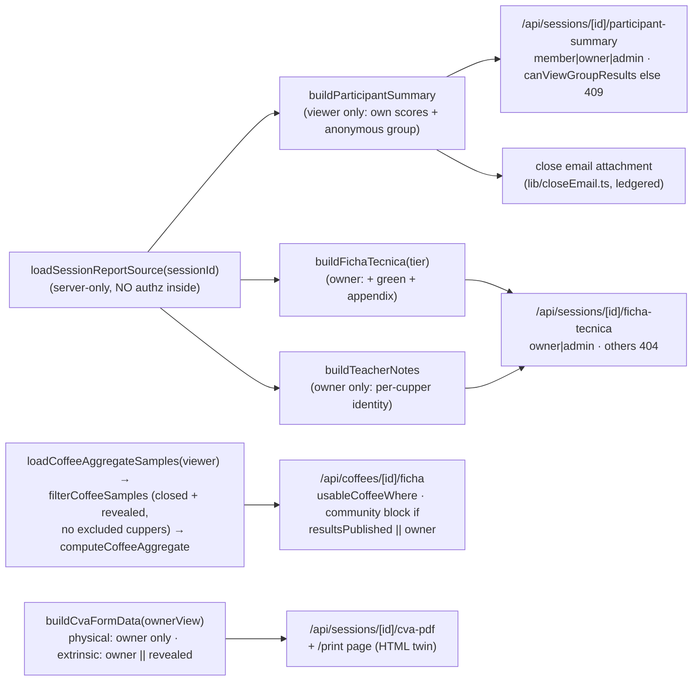

Tiers are entitlements, not billing: **participant** = `participant-summary`
(never another cupper's name/id, never physical data — asserted in
`tests/reports.test.ts`); **owner** = `ficha-tecnica` (+ teacher notes). All
documents register fonts once (`lib/pdf/fonts.ts`) and draw charts with the
`lib/pdf/charts.tsx` SVG primitives; `?inline=1` opens the native viewer
(iOS) instead of downloading. New reports are PDF-only — `PrintClient.tsx`
stays the HTML twin of the CVA form only.

**Blind-leak gates (S8-02)** — data the UI hides must not be serialized either,
each gate is a pure, tested helper shared by every consumer:

- `sheetSampleIdentity` / `sheetSampleRecords` (`lib/pdf/sheetSource.ts`): coffee
  name + roast only once the sample is `revealed` (owner not exempt); physical
  owner-view only, extrinsic owner-view or revealed. Used by `/print`, `cva-pdf`
  and the close email. `/print` for a super-admin renders the OWNER's sheet
  (same `viewAsId` lens as cva-pdf); the invite QR stays on the real owner.
- `gateSampleForViewer` (`lib/reports/sampleGate.ts`): results payload ships
  `physical` only on the owner/admin lens and no `aggregateScore` while a group
  session's community results are hidden.
- `filterCoffeeSamples` (`lib/coffees/filterCoffeeSamples.ts`) behind
  `loadCoffeeAggregateSamples(coffeeId, viewer)`: the coffee profile and the
  Ficha count **closed + revealed** samples only (D6 a; a coffee used only in
  open sessions shows no results until close), drop `excludedFromResults`
  cuppers before counting, and expose session name/date only for sessions the
  viewer owns or joined (admin: all). Other sessions still feed the anonymous
  totals. "Recent tastings" = the viewer's own evaluations plus every evaluation
  of sessions they own.
- Coffee `notes` render for the owner/super-admin only; `duplicableFields`
  (`lib/coffeeDuplicate.ts`) is the allow-list a duplicate copies from.
- D8 (cancelled blind session): unrevealed samples get no history row; label-only
  rows ("Muestra B", nullable `coffeeId`) wait for Kim's answer.

---

### Insights scope, audit trail and legal switch (2026-11, S8-08)

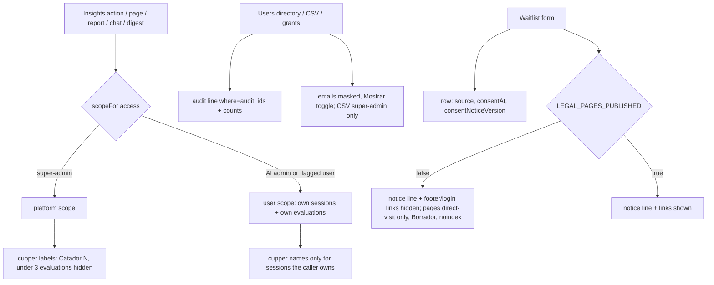

## 7. Offline drafts and replay (S8-09)

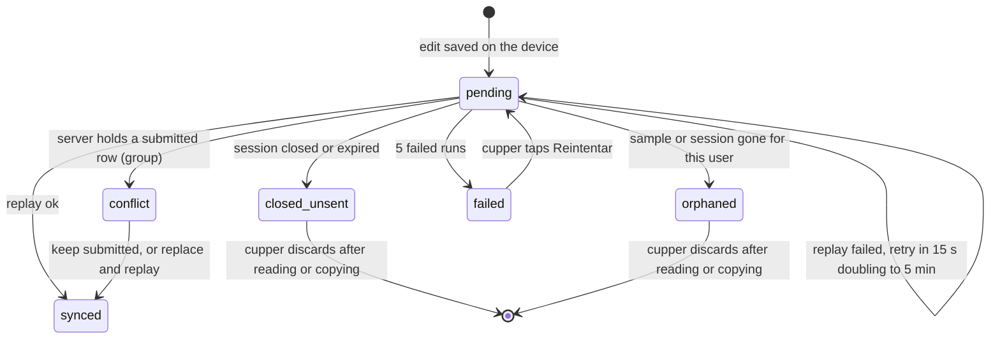

- Replay runs on the online edge, on resume (tab visible, `pageshow`, via `hooks/useResume.ts`),
  once on an online mount and on the retry schedule. One module-level lock means the cup screen,
  the results pill and the guard provider never replay at once.
- The replay result is applied only if the module's `updatedAt` still equals the one sent
  (`applyOutcome`, `lib/offline/status.ts`): an edit made mid-flight stays `pending`.
- Only `pending` blocks the final submit. `failed`, `closed_unsent` and `orphaned` never do; the
  cup screen names them in a notice and the app-shell badge opens "Notas sin sincronizar"
  (read, copy, confirmed discard; nothing is deleted automatically).
- `conflict` is rebuilt from the stored blobs, so it survives a reload.
- Sign-out and the guest claim ask first when anything exists only on the device
  (`UnsyncedGuardProvider`). The claim stores the anonymous id in `cata_claim_anon`; the next app
  mount under the signed-in account re-keys the blobs (`rekeyUserBlobs`).
- Replay actions return `synced | conflict | closed | pending | gone | rejected` and never throw
  for those; `syncEvaluation` keeps its legacy contract for cached bundles.
- Service worker v3: static cache capped at 120 entries, `/app/insights` and `/app/profile`
  never cached, page caches purged when the signed-in id differs from the last one.
- TODO(C1): sending a `closed_unsent` note to the session owner is a post-close write and waits
  for Kim. TODO(E5): creating a session offline waits for Kim; only detection and the message ship.

---

## Maintenance checklist

When you touch any of these, update the matching diagram **in the same PR**:

- A report route, a `lib/reports/*` builder, or the close-email attachment policy → §6.

- Session status transitions, the close routine, delete semantics or `sessionHref` rules → §1
- `usableCoffeeWhere`, visibility values, share/invite semantics, delete cascades → §2
- Group membership linking, invites, posts, leave/remove → §3
- Any new cross-section navigation or a new consumer of `UserCoffeeHistory` → §4
- Analytics scope, admin audit/masking, legal pages switch or waitlist consent fields → the S8-08 diagram above
- Results page tab structure, gating (owner vs. participant), or the drill-down dialog → §5

## Scoring below five cups (S8-04)

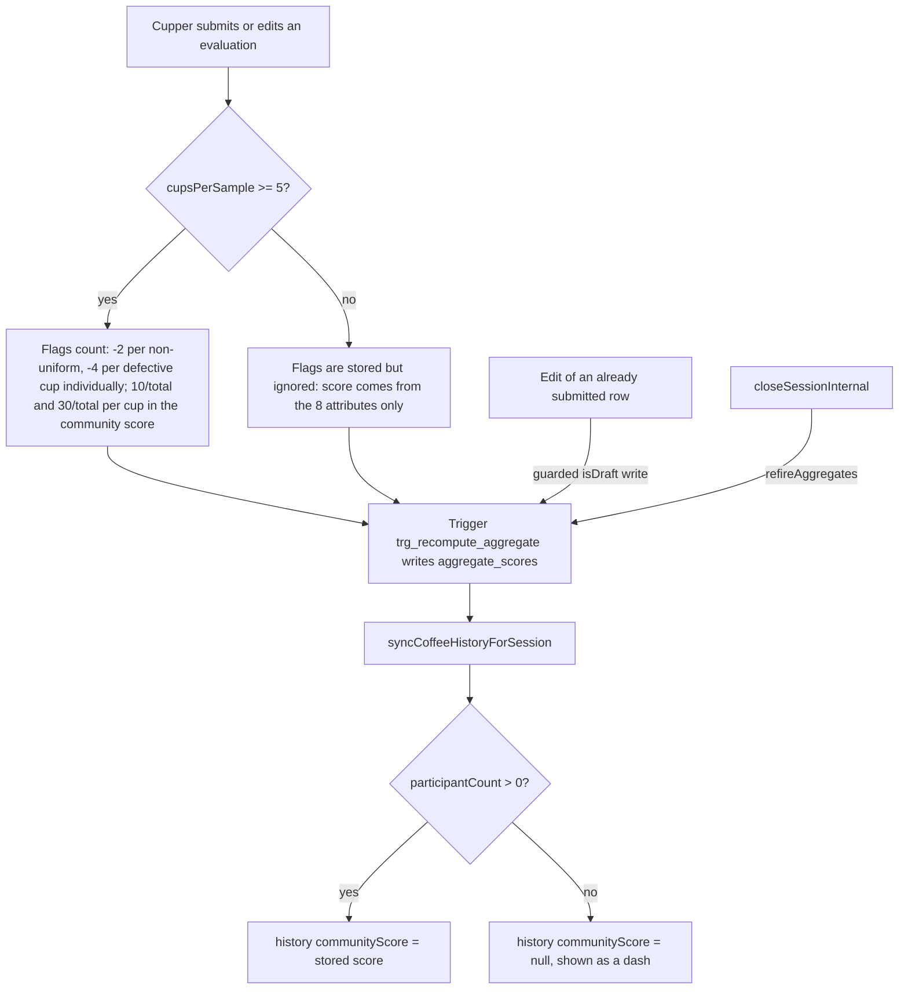

The same `penaltiesApply` rule feeds the individual score, the group aggregate shown on results and the trigger, so a coffee never shows two scores. Sessions under five cups carry an "Impresión rápida" tag in history and on the coffee profile.
