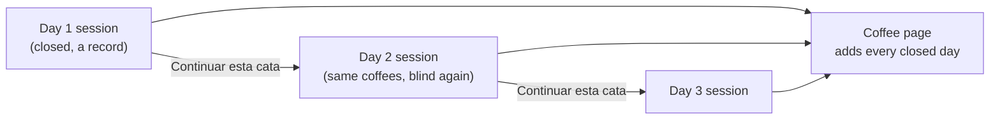

# Results and the life of a tasting: a proposal (2026-11-16)

**For:** Ricardo. **Status:** proposal only. Nothing in the app changes until you decide.
**Why now:** you described how results and a tasting's life should work. Three points of that
model are not what the app does today. All three touch the close and sync machinery, so this
document lays out the options before anyone writes code.

How to read the marks: every statement about the code was checked by reading the file named next
to it, unless it carries **[not verified]**.

---

## Verdict first

| | Today | What you asked | My recommendation | Size |
|---|---|---|---|---|
| **1. Preliminary group results** | The organizer sees the group's numbers at any time and refreshes them with "Actualizar". A cupper sees them only once the session is closed or its closing date passed. | Preliminary results, updated when "Actualizar" is pressed. | **Keep it as it is** for cuppers. If you want cuppers to see them too, do it only for a cupper who has sent everything, and lock their evaluation from that moment. | Keep: none. Cuppers too: medium (code, one SQL phase you apply by hand, tests). |
| **2. A tasting that keeps adding to a coffee** | A coffee's page adds up every **closed** session of that coffee. An open session adds nothing until it closes. | One day's cupping ends, the tasting goes on, and a later cupping of the same coffee adds to the same results. | **Do not let open sessions count.** Make "one session per day, all on the same coffees" an explicit action, **"Continuar esta cata"**, and let the coffee page be the place where the days add up (it already is). | Small (code only, no SQL). Medium if the days are linked into one series page. |
| **3. Reopening a closed session** | Closed is final. Nothing reopens it. That was your own decision (C9, "nunca reabrir"). | The organizer can close and also reopen. | **No true reopen.** The same "Continuar esta cata" action gives you a new day on the same coffees, which is what reopening is for. | True reopen: large and risky. "Continuar": the small change of point 2. |

One action, "Continuar esta cata", answers both point 2 and point 3. That is the heart of this
proposal.

---

## 1. Preliminary group results for a cupper

### What happens today

- **One rule decides who sees the group.** `canViewGroupResults` in `lib/sessionState.ts`: a group
  session, and then the organizer (or the admin lens) at any time, everyone else only once the
  session is closed or its closing date has passed. Its one caller is `viewerMayReadGroupResults`
  in the same file, used by the results page (`app/[locale]/app/sessions/[id]/results/page.tsx`)
  and the participant-summary PDF route (`app/api/sessions/[id]/participant-summary/route.ts`).
- **"Everyone has sent" no longer opens it.** It did until S10 (Kim C5, a SIMULATED answer:
  "Solo al cerrar. Si ves el grupo antes, te sesga, y en una asíncrona le estropeas la cata a
  quien aún no ha catado", `docs/product/kim-flows-2026-11/respuestas-kim-2026-11.md`).
- **The organizer's view is already "preliminary, updated on demand".** On the results page the
  organizer gets a live counter of new submissions (a realtime subscription on evaluations,
  `ResultsClient.tsx`, owner branch). "Actualizar" recomputes the group scores while the session is
  open (`refreshAggregateScores`, `app/actions/community.ts`) and reloads the page. Once the session
  is closed or past its date the button is hidden and the action does nothing, so a past score is
  never rewritten.
- **A cupper's "Actualizar" only reloads the page.** It shows their own results; the group's stay
  hidden until close.
- **The database twin.** `public.can_view_group_results` (PHASE 28 in
  `prisma/sql/rls_and_triggers.sql`) says the same thing. It guards only the `aggregate_scores`
  table over the browser key; the app itself reads through Prisma and never through that policy,
  and no browser code reads that table (stated in the PHASE 21 comment; my search of `app`,
  `components`, `hooks` and `lib` found no browser read either).
- **Important detail: a sent evaluation can still be changed while the session is open.** The save
  path rewrites a submitted row and recomputes the group score (`lib/evaluationWrite.ts`, using
  `submittedRefireArgs` from `lib/aggregateRefire.ts`), and the results page shows "back to cupping"
  while the session is open (`ResultsClient.tsx`). Whether every form on the cup page stays
  editable after "Enviar" is **[not verified]** in `CupClient.tsx`.

### What your model asks

"Preliminary results are shown and updated once the update button is pressed." For the organizer
this is exactly today's behaviour. For a cupper it is not.

### Options

**A. Leave it as it is (recommended).**
- Cupper: sees their own score after sending; the group appears at close.
- Organizer: unchanged, preliminary view with the live counter and "Actualizar".
- Work: none.

**B. A cupper who has sent every sample sees the preliminary group, and their evaluation locks.**
- Cupper: after "Enviar" for every sample, the results page shows the group's numbers as they are
  now, with "Actualizar" to refresh them. From that moment their own ratings cannot change (the
  "back to cupping" button goes away for them).
- Organizer: unchanged.
- Why the lock: without it, a cupper sees the group and then goes back and moves their own numbers
  toward it. That is the bias Kim's answer is about.

**C. Like B, but only in live sessions (no closing date).**
- In a live session everyone is in the room and finishes around the same time, so seeing the group
  early spoils little. In a self-paced session (a closing date) someone who has not cupped yet
  could hear the numbers from someone who has.
- Cupper and organizer: as B, live sessions only.

### Risks of B and C

- **Bias.** A cupper who has not sent must never see others' numbers. The rule would check "this
  cupper has sent every sample", per cupper, not "everyone has sent".
- **Changing a sent evaluation after seeing the group.** Covered by the lock. Without the lock,
  B and C should not be built.
- **Blind samples.** The group numbers carry no coffee name; the page already hides the coffee of an
  unrevealed sample (`gateSampleForViewer`, `lib/reports/sampleGate.ts`). No new leak, but this must
  be tested again for the new viewer.
- **Anonymity.** A cupper would see group averages and the spread, never another cupper's name or
  row. The personal comparison "tú vs. grupo" is built for closed sessions only today
  (`lib/reports/comparisonGates.ts`); it would stay that way unless you ask.
- **Late evaluations.** After close, a late evaluation may already have been written knowing the
  answer; the organizer sees that label when accepting it (`LateEvaluationsPanel`, runbook §36).
  With B or C more people know the answer earlier, so more late evaluations would carry that label.
- **Numbers that move.** A cupper would see a group score that changes after they look. The page
  would need a line such as "Resultados preliminares: cambian hasta el cierre".

### The work for B or C

- TypeScript: the visibility rule gains "this viewer has sent every sample" (and, for C, "live
  session"); a lock rule refuses saves from such a cupper; the page copy for "preliminary".
- SQL: a new phase (PHASE 30) re-issuing `can_view_group_results` so the database twin agrees, with
  its dry run in `prisma/sql/dry-runs/`, a replay test like `tests/phase28Sql.test.ts`, and a runbook
  section. You apply it by hand, as with PHASE 28.
- No migration.
- Tests: the visibility rule, the lock on the live save and the offline replay, the PDF route, the
  blind-sample gate for the new viewer, and the database suite (`npm run test:db`).

### To ask Kim

- C5 again, with the new detail: "Una persona que ya envió todo, ¿puede ver el resultado provisional
  del grupo si su evaluación queda bloqueada desde ese momento? ¿Solo en una cata en vivo, o también
  en una con fecha de cierre?"

---

## 2. A tasting that keeps adding to a coffee

### What happens today

- **The coffee page adds up closed sessions only.** `filterCoffeeSamples`
  (`lib/coffees/filterCoffeeSamples.ts`) keeps a sample only when its session is closed and the
  sample is revealed, drops excluded cuppers, and feeds the coffee's lifetime score
  (`lib/coffeeLifetimeScore.ts`, computed when the page is read, never stored). The database query
  in `lib/coffees/aggregateSamples.ts` already asks for closed sessions only. The coffee page and the
  coffee PDF are its two callers.
- **Why closed only:** the close reveals every coffee (`lib/closeSession.ts`), so a closed session
  can never leak which letter was which coffee. An open session's samples are still blind.
- **A session past its closing date but not yet closed** counts only after the nightly job closes
  it (the job runs daily at 06:00 UTC, `vercel.json`).
- **Coffee history** (each cupper's list of coffees tasted) is written at the close and by the few
  sanctioned writes after it (`syncCoffeeHistoryForSession` callers: the close routine, an
  exclusion, an accepted late evaluation, naming a coffee after close, a guest claim).

### How "a second person cups the same coffee later" works today

| Way | Does it add to the coffee? | Fits your model? |
|---|---|---|
| **A self-paced session** (a closing date): people cup on different days, the session closes at the date. | Yes, once at the close. | Yes, if you know the last day in advance. |
| **A new or duplicated session on the same coffees** ("Duplicar", `duplicateSession`, `app/actions/sessions.ts`: same coffees, fresh random letters, no closing date, a new invite). | Yes, each one when it closes; the coffee page shows all of them together. | Yes in substance. What is missing is that the app does not present it as "the same tasting, another day": the copy is named "Copia de …" and nothing links the two. |
| **A late evaluation accepted by the organizer** after close (`acceptLateEvaluation`, `isAcceptableLate` in `lib/lateContributions.ts`). | Yes, it recomputes that sample and refreshes history. | No. It only covers people who were already in the session and had an unsent draft. A newcomer cannot join a closed session (`lib/joinRules.ts` answers "closed"). |

So the second way already gives you the result you want on the coffee page. The gap is in how it
is presented and named, not in the numbers.

### Options

**A. Leave it as it is.**
- Organizer: uses "Duplicar" for the next day.
- Cupper: unchanged.
- Work: none.

**B. "Continuar esta cata" (recommended).** A button on a closed session's results page (organizer
only) that creates the next day's session on the same coffees.
- Organizer: one tap; the new session is named after the first ("… · día 2"), keeps format, cups
  and reference mode, has fresh random letters, and a new invite link to share. The coffee page adds
  both days together, as it does today.
- Cupper: a new invite for a new day; cups blind as always; sees their own results that day and the
  group's at that day's close.
- It is today's "Duplicar" with a clear name and a clear place. Each day stays a closed record.

**C. B, plus a "series" that ties the days together.** The second session remembers which session
it continues, and the results page of any day can show "Esta cata continúa la del 12 de noviembre"
and a combined view of all days.
- Organizer: sees one tasting over several days.
- Cupper: sees the link to earlier days.
- This needs a new column on the session table (a migration) and a combined results view that does
  not exist today.

**D. Let an open session count toward the coffee (not recommended).**
- Cupper: the coffee page would show numbers from sessions still in progress.
- Organizer: the coffee's score moves every time someone sends.

### Risks

- **Option D leaks blind samples.** Someone who cupped sample B can watch the coffee's score move
  right after they send, and learn that B is that coffee. Counting only revealed samples of open
  sessions does not help: a revealed sample of an open session takes no more ratings (the reveal
  freeze, `evaluationWriteRefusal` in `lib/sessionState.ts`), so nothing new would arrive anyway.
- **Option D makes numbers move,** on the coffee page and the coffee PDF, while the session that
  feeds them can still change (sent evaluations can still be edited, exclusions can still happen).
- **Option D and the special cases.** The quick-impression rule (one cup per sample) and the
  anchor-reference rule (a pinned 79.00 never counts) were written for closed sessions; both would
  have to be rechecked for open ones.
- **B and C** carry no such risk: each day closes through the same close routine as today.
- **For B and C, the days are not identical cuppings.** The coffee is older on day 2, the people
  differ. The coffee page already pools sessions from different days, so this is not new, but Kim
  should say whether a "series" should be shown as one result.

### The work

- **B:** TypeScript only. A new owner action built on `duplicateSession`, its button and copy (Spanish
  and English), and tests. No SQL, no migration, no change to the close or to scoring.
- **C:** B plus a migration (a nullable column naming the session it continues; you run
  `migrate deploy` before the deploy, as usual), a combined results view, tests, and a runbook
  section. No SQL phase if the new column is only read by the server (a column the browser should
  see would need a GRANT in a new phase).
- **D:** changes to `filterCoffeeSamples`, the query in `aggregateSamples.ts` and the lifetime
  score's rules, plus a careful review of every blind-data gate. Not recommended.

### To ask Kim

- "Cuando el mismo café se cata en días distintos, ¿el resultado del café debe sumar todos los días
  (como hoy en la página del café), o cada día es un resultado aparte?"
- "Una segunda cata del mismo café, ¿debe ser ciega otra vez para quien no estuvo el primer día?"

---

## 3. Reopening a closed session

### What happens today

- **Closing does four things, in this order** (`finalizeClosedSession`, `lib/closeSession.ts`):
  reveals every sample that has a coffee, recomputes the group scores, writes each cupper's coffee
  history, and for a group session sends the close emails. Then it stamps the session as finished.
- **After that the session is read only.** Every write checks `assertSessionWritable`
  (`lib/sessionState.ts`), which refuses a closed session or one past its date. The few writes
  allowed after close are listed in `docs/flows.md` section 1 (origin data, exclusions, naming a
  coffee, accepting a late evaluation, sending a late draft, a note after close, account deletion
  and guest claim).
- **The database also refuses browser writes to a closed session** (PHASE 21). This only concerns
  the browser key: the app's own writes go through Prisma and are not blocked by it.
- **Nothing reopens a session.** Even the closing date cannot be changed once it passed
  (`canEditSessionSettings`, Kim C9). The simulated answer for C9 was "Nunca reabrir. Si alguien no
  terminó, se hace otra cata", and `kim-validar-S10.md` records that C9 was **your** decision, not a
  simulated one. What you said now reverses it.

### What a true reopen would have to undo or live with

| What closing did | What happens on reopen |
|---|---|
| **Every coffee was revealed.** | It cannot be un-revealed: everyone already saw the names. A revealed sample of an open session takes no more ratings (the reveal freeze, `evaluationWriteRefusal`). So in a reopened session **nobody could cup any sample that has a coffee**, unless the freeze is lifted for it, and then people would cup knowing the coffee. |
| **Group results became visible to everyone.** | The visibility rule would hide them again from cuppers while the session is open. People who saw them would lose them, then see them again at the next close. |
| **Close emails were sent.** | The email ledger keeps one row per session and person (`CloseEmailDelivery`, key `sessionId` + `userId`, `prisma/schema.prisma`). At the second close, people who already got an email would **not** get one with the new numbers, unless the ledger is reset, and then they get a second email. |
| **Coffee history was written.** | The rows exist and the next close rewrites them (the sync is designed to be repeated). While open, the coffee page would drop that session (it counts closed sessions only), so the coffee's numbers would go down and come back. |
| **The closing date passed** (if it had one). | The reopened session is still past its date, so it is still read only, and the nightly job would close it again. A reopen must set a new date or clear it, which C9 forbids today. |
| **Idle auto-close.** | A reopened live session with no recent activity would be closed again by the idle rule: by the nightly job after 7 idle days, silently after 30 (`lib/idleClose.ts`, `idleCloseDecision` in `lib/closeRules.ts`). Which exact candidates the job picks after a reopen is **[not verified]**. |
| **Late evaluations and notes after close.** | Those features exist only for closed sessions. A late draft waiting for the organizer would have to be decided before reopening, or it would sit in a state nobody designed. |
| **Score rule versions.** | The close keeps scores computed under the old rule (`keep-old-rule`, `lib/aggregates.ts`); "Actualizar" on an open session recomputes everything under the current rule (`mode: "full"`). Reopening an old session and pressing "Actualizar" would move its old scores to the current rule. You decided past scores never change; a reopen would break that unless it is limited to sessions closed after 2026-11. |

### Options

**A. Keep "closed is final" (today).**
- Organizer: for another day, makes a new session.
- Cupper: unchanged.

**B. "Continuar esta cata" (recommended; the same action as point 2, option B or C).**
- Organizer: on a closed session, one tap starts the next day on the same coffees. The closed day
  stays as it was: its results, its emails, its history.
- Cupper: a new day, blind again, with its own close.
- Nothing has to be undone, because nothing is reopened.

**C. Widen late acceptance.** Let newcomers join a closed session and cup, with the organizer
accepting each evaluation.
- Cupper: cups a closed session whose coffees and group results are already public. Every such
  evaluation is written knowing the answer.
- Organizer: accepts evaluations one by one.
- Needs changes to the join rules, the write gates and the list of allowed writes after close. Not
  recommended: it gives you a mixed record where blind and non-blind ratings sit together.

**D. True reopen.** An organizer action that sets the session back to open.
- Needs answers to every row of the table above, a change to the reveal freeze, a new email rule,
  a new date rule, and probably a new SQL phase. Large, and it touches the close routine you asked
  us to treat with care. Not recommended.

### The work

- **B:** see point 2 (TypeScript only; plus a migration if you want the days linked).
- **C:** medium to large (join rules, write gates, `docs/flows.md` section 1 and the allowlist in
  `tests/useServerExports.test.ts`, copy, tests).
- **D:** large (close routine, reveal freeze, email ledger, date rule, idle rule, score-rule guard,
  likely an SQL phase and a migration for a "reopened at" stamp, tests on the database suite,
  runbook section).

### To ask Kim

- C9 again: "Si el organizador quiere seguir una cata otro día, ¿basta con una cata nueva sobre los
  mismos cafés, enlazada a la primera? ¿O necesitas que la misma cata se reabra?"

---

## What already matches your model

- **Preliminary results for the organizer, refreshed on demand.** The organizer sees the group's
  numbers while the session is open, with a live "new submissions" counter and "Actualizar", which
  recomputes and reloads (`ResultsClient.tsx`, `refreshAggregateScores`).
- **Late senders after close.** A cupper who could not send in time can send a draft to the
  organizer after the close (`submitLateDraft`, `app/actions/offline.ts`), and the organizer accepts
  it one by one, seeing whether it was written before or after the results were public
  (`acceptLateEvaluation`, runbook §36). An accepted one recomputes that sample and refreshes
  history.
- **Cupping on different days in one session.** A session with a closing date is self-paced: each
  person cups on their own day and the session closes at the end of the chosen day.
- **A coffee that gathers every cupping of it.** The coffee page adds every closed session of that
  coffee into one lifetime score, with the defect tally, whoever ran each session.
- **Another day on the same coffees.** "Duplicar" already makes it, with fresh random letters.

---

## Decisions for you (each answerable in one word)

1. **Should a cupper ever see preliminary group results before the close?** (Yes / No)
2. If yes: **only once they sent everything, with their evaluation locked from then on?** (Yes / No)
3. If yes: **in self-paced sessions too, or only live ones?** (Both / Live)
4. **Should an open session count toward a coffee's page?** (Yes / No; I recommend No)
5. **Build "Continuar esta cata" on a closed session's results page?** (Yes / No)
6. If yes: **link the days into one series with a combined view?** (Yes / Later)
7. **Allow a true reopen of a closed session?** (Yes / No; I recommend No)
8. **Send points 1, 4 and 7 to Kim before building anything?** (Yes / No)

Whatever you decide on 1, 3 and 7 updates Kim's codes C5 and C9 in `docs/product/kim-validar-S10.md`.
